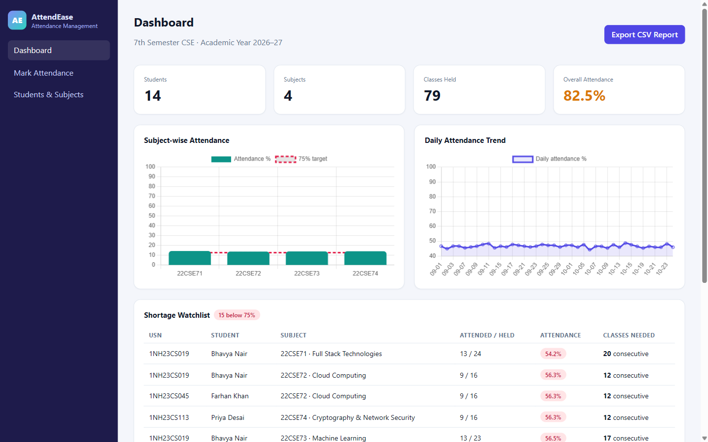
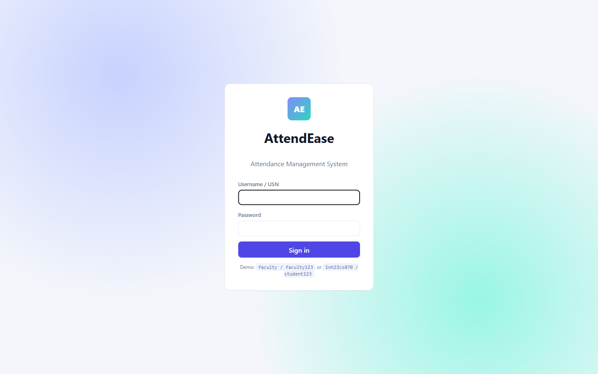
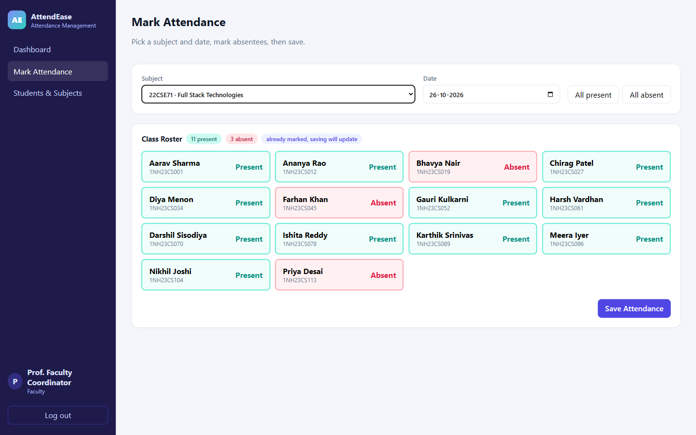
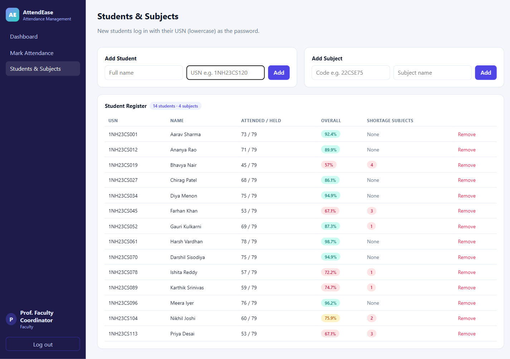
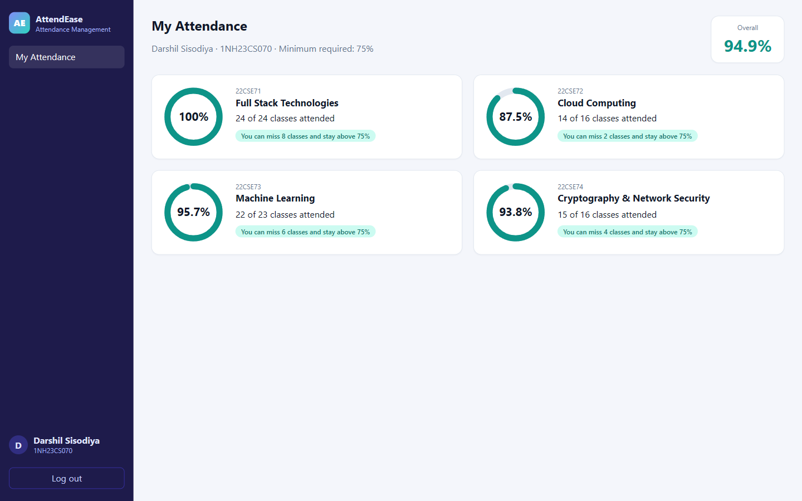

# AttendEase – Attendance Management System

A full-stack web app for recording class attendance and catching attendance shortages early. Faculty mark attendance per subject per day; students see their subject-wise percentage and exactly how many classes they need (or can afford to miss) to stay above the 75% requirement.

Built for **Full Stack Technologies (22CSE71) – AAT-1** by Darshil Sisodiya (1NH23CS070), New Horizon College of Engineering.



## Features

**Faculty**
- JWT login with role-based access (faculty / student)
- Dashboard: total students, subjects, classes held, overall attendance %
- Subject-wise attendance bar chart with the 75% target line, and a daily attendance trend line chart
- Shortage watchlist: every student–subject pair below 75%, with the number of consecutive classes needed to recover
- Mark attendance: pick subject and date, tap to toggle absentees, save (re-saving the same day updates the records)
- Add / remove students and add subjects
- Export the full attendance report as CSV

**Student**
- Subject-wise attendance rings, colour-coded (green ≥ 85%, amber 75–85%, red < 75%)
- "Attend the next N classes" or "You can miss N classes" for every subject

## Tech stack

| Layer | Technology |
|---|---|
| Frontend | React 19, Vite, Chart.js, CSS |
| Backend | Node.js, Express 5, REST API |
| Database | SQLite (built-in `node:sqlite`) |
| Auth & security | JSON Web Tokens, scrypt password hashing (`node:crypto`), parameterised SQL |
| Testing | `node:test` |

## Project structure

```
attendance-management-system/
├── server/
│   ├── index.js            # Express app + REST routes
│   ├── db.js               # SQLite schema, password hashing
│   ├── attendance.js       # Percentage / classes-needed / can-skip maths
│   ├── attendance.test.js  # Unit tests for the maths
│   └── seed.js             # Demo data (14 students, 4 subjects, Sep–Oct 2026)
├── client/
│   ├── src/App.jsx         # Layout, role-based navigation
│   ├── src/api.js          # Fetch wrapper with JWT
│   ├── src/ChartBox.jsx    # Chart.js wrapper
│   └── src/pages/          # Login, Dashboard, MarkAttendance, Students, StudentPortal
└── docs/screenshots/
```

## Running locally

Requires **Node.js 22.13+**.

```bash
# 1. Backend
cd server
npm install
npm run seed      # creates attendance.db with demo data
npm test          # runs the unit tests
npm start         # API on http://localhost:5000

# 2. Frontend (new terminal)
cd client
npm install
npm run dev       # http://localhost:5173 (proxies /api to :5000)
```

For a single-server setup run `npm run build` in `client/`; the Express server then serves the built app at http://localhost:5000.

**Demo logins**

| Role | Username | Password |
|---|---|---|
| Faculty | `faculty` | `faculty123` |
| Student | `1nh23cs070` (any seeded USN, lowercase) | `student123` |

Set `JWT_SECRET` in the environment for anything beyond local use.

## API

| Method | Endpoint | Role | Purpose |
|---|---|---|---|
| POST | `/api/login` | – | Returns JWT + profile |
| GET | `/api/summary` | faculty | Dashboard totals, charts data, shortage list |
| GET / POST | `/api/attendance` | faculty | Roster for subject+date / save attendance (upsert) |
| GET / POST / DELETE | `/api/students` | faculty | Student register with overall % |
| GET / POST | `/api/subjects` | any / faculty | List / add subjects |
| GET | `/api/me` | student | Own subject-wise attendance + classes needed |
| GET | `/api/export.csv` | faculty | CSV report |

## The 75% maths

With `P` classes attended out of `T` held and target `t` (75):

- Classes needed: smallest `x` with `(P + x) / (T + x) ≥ t/100` → `x = ⌈(t·T − 100·P) / (100 − t)⌉`
- Classes you can miss: largest `y` with `P / (T + y) ≥ t/100` → `y = ⌊(100·P − t·T) / t⌋`

Integer arithmetic keeps the 75% boundary exact (no floating-point rounding).

## Screenshots

| | |
|---|---|
|  |  |
|  |  |
